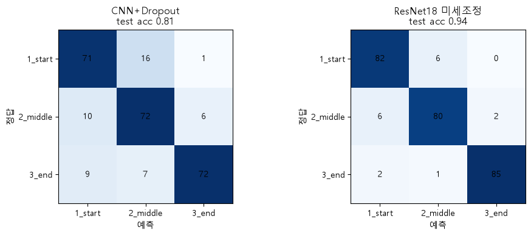
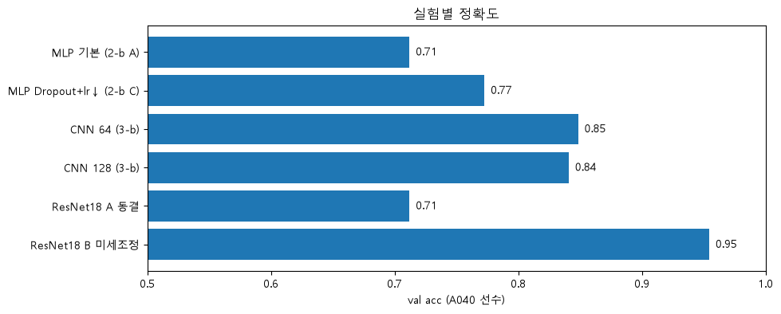

# 태권도 자세 분류: OpenCV 전처리 → MLP → CNN → 전이학습

AI Hub 태권도 동작 사진을 보고 **동작의 시작 / 중간 / 끝 자세 중 어느 순간인지** 맞히는 3클래스 이미지 분류 프로젝트입니다.
OpenCV로 데이터를 정리하고, MLP → CNN → Dropout → 전이학습(ResNet18) 순서로 모델을 개선한 뒤,
마지막에 train / val / test를 나눠 **처음 보는 사람**에 대한 정확도를 확인했습니다.

> ROKEY 11기 스터디 · AI개론 9~15차시(다중분류, CNN, 과적합, 전이학습, Custom Dataset) 응용

## 결과

처음 보는 선수(A040) 264장으로 채점한 정확도입니다.

| 모델 | 학습 파라미터 | 입력 크기 | test 정확도 |
|---|---:|---|---:|
| CNN + Dropout | 55만 | 64 × 64 | **0.81** |
| ResNet18 미세조정 (전이학습) | 1,118만 | 224 × 224 | **0.94** |



실험별 비교 (같은 사람으로 epoch를 고르고 채점해서 조금 부풀려졌을 수 있는 중간 점수):



| 실험 | 결과 | 알게 된 것 |
|---|---|---|
| MLP vs CNN | 0.69 vs 0.85 | CNN은 파라미터가 1/12인데 더 정확함 (위치 정보) |
| MLP + Dropout + 낮은 학습률 | 0.71 → 0.77 | 과적합이 줄고 학습이 안정됨 |
| CNN 입력 64 vs 128 | 0.85 vs 0.84 | 효과 없음, 계산량만 4배 |
| CNN + Dropout | 0.83 → 0.86 | 과적합 조금 감소 |
| ResNet18 동결 / 미세조정 | 0.71 / 0.95 | 미세조정이 압도적, 동결만 하면 오히려 낮음 |
| train / val / test 분리 | CNN 0.81, ResNet 0.94 | val로 고르고 채점하면 약 5%p 부풀려짐. val도 대표성이 중요 |

자세한 과정과 그래프는 [`tk_report.html`](tk_report.html)에 정리했습니다. (내려받아서 브라우저로 열어보세요)

## 파일 구성

| 순서 | 파일 | 내용 |
|---|---|---|
| 1 | `tk_1_opencv.ipynb` | json 라벨 읽기, 초록 배경 제거(HSV), 윤곽선·IoU, 사람만 잘라 `tk_crops/` 생성 |
| 2 | `tk_2_multiclass.ipynb` | MLP 다중분류 |
| 3 | `tk_3_cnn.ipynb` | CNN 분류, shape 변화와 특징 맵 |
| 4 | `tk_2b_mlp_improve.ipynb` | MLP + Dropout + 학습률 비교 (Early Stopping) |
| 5 | `tk_3b_cnn_128.ipynb` | CNN 입력 크기 64 vs 128 |
| 6 | `tk_4a_cnn_dropout.ipynb` | CNN + Dropout |
| 7 | `tk_4b_transfer_resnet18.ipynb` | ResNet18 전이학습 (동결 / 미세조정) |
| 8 | `tk_5_train_val_test.ipynb` | train / val / test 평가 (val = 한 사람, 실패 사례) |
| 9 | `tk_5b_random_val.ipynb` | train / val / test 평가 (val = 무작위 20%, **최종**) |
| | `tk_report.html` | 전체 실험 정리 보고서 |

## 실행 방법

### 1. 데이터 준비

데이터는 저장소에 포함되어 있지 않습니다. [AI Hub](https://www.aihub.or.kr)에서 **태권도 동작 데이터**를 신청해서 받은 뒤,
**'뒷굽이하고 바깥막기'** 동작의 원천데이터와 라벨링데이터를 아래처럼 두세요.

```
상위폴더/
├─ taekwondo_data/
│  ├─ 원천데이터/TS1/뒷굽이하고 바깥막기/...jpg
│  └─ 라벨링데이터/TL2/뒷굽이하고 바깥막기/...json
└─ taekwondo_review/        ← 이 저장소
```

위치가 다르면 `tk_1_opencv.ipynb`의 `DATA_ROOT`만 바꾸면 됩니다.

### 2. 설치

```bash
pip install opencv-python numpy matplotlib scikit-learn torch torchvision
```

GPU(CUDA)가 있으면 빠르고, 없어도 돌아갑니다. ResNet18 가중치(약 45MB)는 처음 실행할 때 자동으로 받습니다.

### 3. 실행

`tk_1_opencv.ipynb`를 먼저 실행해서 `tk_crops/` 폴더를 만든 뒤, 나머지 노트북을 순서대로 실행합니다.

## 데이터와 분할

- 사진 1,197장 (시작 / 중간 / 끝 각 399장), 선수 7명 (A035 ~ A040, B002)
- 파일 이름 끝 `S01` / `M01` / `E01`을 정답으로 사용
- 같은 사람 사진이 train과 test에 섞이지 않도록 **선수 단위로 분할**
  - 최종(`tk_5b`): test = A040 전체, 나머지 선수 사진을 train 80% / val 20%로 무작위 분할

## 배운 것

1. 공공데이터는 그대로 쓸 수 없어서, OpenCV로 "정답별 폴더" 모양을 만드는 전처리가 먼저 필요했다.
2. 이미지에는 위치 정보를 살리는 CNN이 MLP보다 훨씬 효율적이다.
3. Dropout은 과적합을 줄인다 (MLP에서 효과 큼).
4. 데이터가 적을 때는 전이학습(미세조정)이 가장 좋았다. 동결만 하면 오히려 낮았다.
5. 모델을 고를 때 쓴 데이터로 채점하면 점수가 부풀려진다. test는 마지막에 한 번만.
6. val도 대표성이 중요하다. 특이한 한 사람을 val로 쓰니 Early Stopping이 너무 일찍 멈췄다.

## 한계

- test가 한 사람(264장)뿐이라 다른 선수로 바꾸면 몇 %p 달라질 수 있음 → 교차검증으로 보완 가능
- 동작이 하나뿐이고, 시작 ↔ 중간 자세는 라벨 경계가 애매한 사진이 있음

## 데이터 출처

AI Hub 태권도 동작 데이터 (https://www.aihub.or.kr).
데이터 이용 조건에 따라 원본 데이터와 이를 가공한 사진은 저장소에 포함하지 않았습니다.
